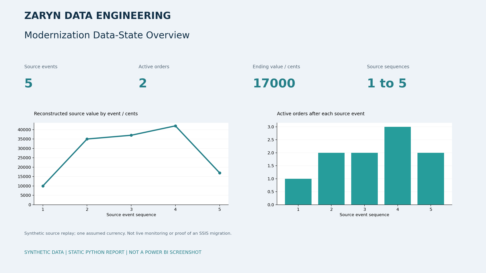

# Zaryn | Modernization Data-State Dashboard



Static Python-rendered portfolio report using synthetic source events. This is not a Power BI screenshot, a live pipeline monitor, or evidence of an executed SSIS migration. The PNG becomes available after the reporting workflow completes successfully.

## Reporting Snapshot

The committed CSV reconstructs current source state after each of the five events in `data/sample/changes.csv`. Values after each event are 10000, 35000, 37000, 42000, and 17000 cents. Active-order counts are 1, 2, 2, 3, and 2. All amounts use one assumed currency. Event sequence is not elapsed time.

This is a fixed snapshot, not a query against `output/demo.db`. If source events change, regenerate and validate the snapshot before rendering. Snapshot refresh is not automated here. The PNG does not establish that reconciliation tests passed; run the repository tests separately.

## Reproduce

From the repository root:

```bash
python -m pip install matplotlib==3.9.4
python reporting.py
```

This replaces `reports/dashboard.png`. The snapshot contains fabricated data, not customer data.

## GitHub Rendering

The Build dashboard workflow runs on changes to the renderer, snapshot CSV, or workflow, and can also be run manually from Actions. It runs the existing tests, renders the PNG, and commits only `reports/dashboard.png` using repository contents-write permission. Branch rules or Actions policy may prevent the commit; if so, generate locally and upload the PNG. No Azure resources are provisioned.
